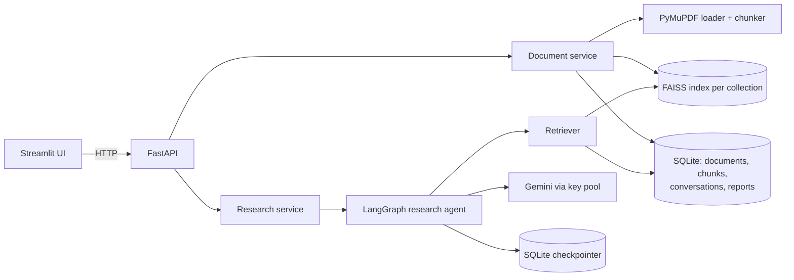
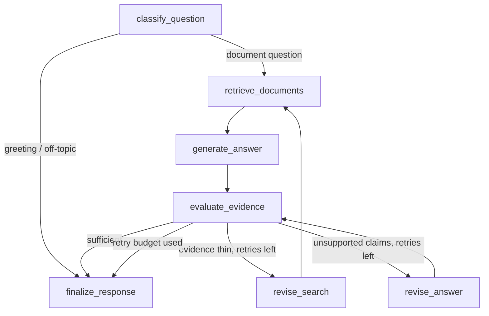
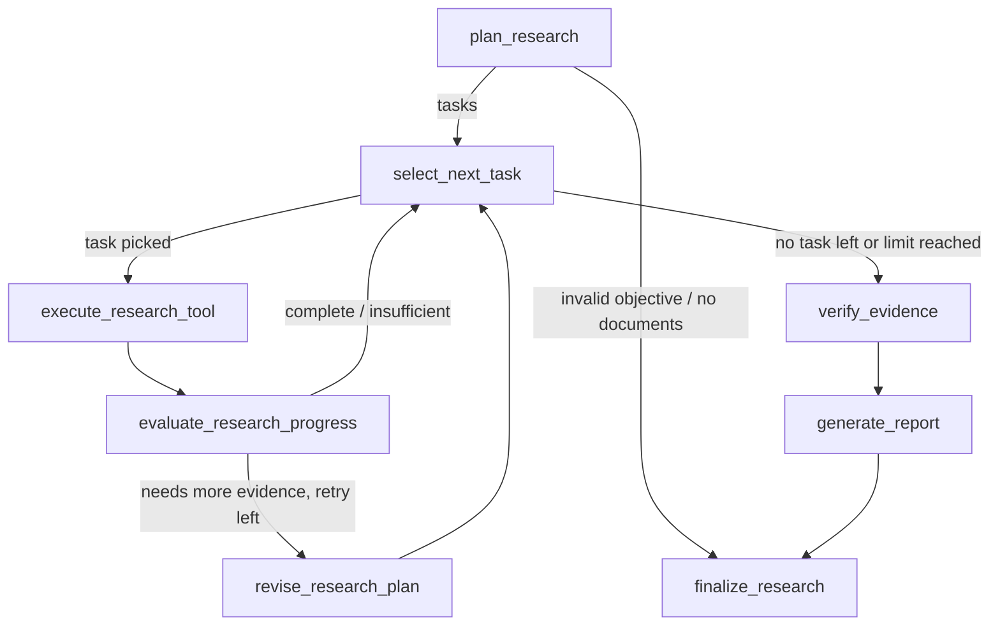

# ResearchFlow AI

**An AI research assistant that answers questions from your own documents — with a citation
for every claim, an agent that fact-checks its own draft, and the honesty to say "the
documents don't say".**

It has two modes:

- **Ask your documents**: grounded Q&A with a self-checking agent.
- **Deep research**: an autonomous research agent that plans tasks, chooses tools, checks
  its evidence and writes a cited report you can download as Markdown.

Upload PDFs or text files, ask a question in plain language, and get an answer where each
statement links to the exact document, page and quote it came from. If the evidence is weak
the agent searches again (up to a fixed retry budget); if the documents don't contain the
answer, it says so instead of guessing.

Built with **Python · LangChain · LangGraph · Gemini · FAISS · sentence-transformers ·
FastAPI · Streamlit · SQLite**.

> **Example.** With three short reports about a fictional town loaded, ask *"Why do the pilot
> report and the council memo give different savings figures?"* — the answer explains that
> the pilot report claims an **18%** reduction while the council memo finds **12%** after
> excluding eleven homes that also installed heat pumps, citing both documents. Ask *"What
> was the hourly wage of the solar installers?"* and it searches three times, then answers
> **"Not found in your documents"**.

---

## Features

- **Grounded answers with citations** — every claim carries source labels (`S1`, `S2`…) that
  map to real retrieved passages; citations are validated in code, never invented.
- **Self-checking LangGraph agent** — classify → retrieve → draft → evaluate → (re-search or
  revise) → finalize. Deterministic checks run first, then an LLM judge.
- **Bounded retries** — the retry limit (default 2) lives in graph state and routing, so the
  agent can't loop forever; the best supported attempt is returned as a *partial* answer.
- **Honest failure modes** — `answered`, `partial`, `insufficient_evidence`,
  `not_applicable`, `error`; nothing is shown as an answer when the model fails.
- **Autonomous research agent (Deep research)**: plans structured tasks, lets the model
  choose real LangChain tools (document search, web search, source inspection,
  comparison, a safe calculator, report creation), re-plans when evidence is thin,
  verifies every finding against its sources, and stops at hard limits. Runs are
  checkpointed and can be resumed after a crash or provider outage.
- **Google sign-in with free credits**: visitors sign in with Google and get free
  credits (2 questions and 2 deep research runs by default). Administrators are unlimited.
  Each user sees only their own history, and only administrators can change the
  document library.
- **Document library** — PDF (PyMuPDF) and TXT ingestion with magic-byte validation, size
  limits, duplicate detection (SHA-256), collections, delete and index rebuild.
- **Semantic search** — sentence-transformers `all-MiniLM-L6-v2` embeddings in a per-collection
  FAISS index; chunk text and metadata live in SQLite.
- **Conversations & reports** — follow-up questions use earlier answers (LangGraph SQLite
  checkpointer); any answer can become a structured Markdown research report.
- **Gemini key pool** — several API keys and fallback models with sticky rotation: when a key
  or model hits its quota, the next one takes over from where it left off.
- **Polished UI** — answer cards with clickable citations, source cards, an "agent path"
  trace, document library and searchable history.
- **Evaluation** — a labelled dataset (including unanswerable questions) with retrieval
  hit@k / MRR and optional LLM-judged answer metrics.

## Architecture



### The research agent (LangGraph)



- **LangChain** provides the prompts, structured outputs (Pydantic schemas), the retriever
  interface and the Gemini chat model.
- **LangGraph** owns the control flow: typed state, pure routing functions, the retry
  counter, and per-conversation memory via the SQLite checkpointer.
- Every node is wrapped so domain errors become an `error` state rather than a crash.

### The deep-research agent (LangGraph)



**Planning.** A short single question skips the planner and becomes one search task (the
lightweight path). Anything else is split by the model into at most `AGENT_MAX_TASKS`
tasks. Each task has an id, a description, an approach (`document_search`, `web_search`,
`comparison`, `calculation` or `mixed`), source requirements, a status
(`pending → in_progress → completed | insufficient | skipped`), an attempt count and notes.

**Tools.** Every tool is a LangChain `StructuredTool` with a Pydantic argument schema and
runs a real application function:

| Tool | What it does |
|---|---|
| `search_documents` | Vector search in the selected collection; registers passages as sources `D1, D2…` |
| `search_web` | Tavily search, only when configured; sources `W1…` keep their real URLs |
| `inspect_source` | Full text and metadata of a gathered source |
| `compare_sources` | Model comparison of 2–8 gathered sources; points that cite other ids are dropped |
| `calculate` | Arithmetic through an AST whitelist. It cannot run code. |
| `create_research_report` | Writes the final report from verified findings |

The model only sees the tools the current task's approach needs (`bind_tools`), and
`search_web` is never offered when no provider is configured. The `ToolExecutor`
validates arguments before running, time-boxes each call (`AGENT_TOOL_TIMEOUT_SECONDS`)
and turns invalid input, empty results, timeouts and provider failures into recorded
`ok=false` results that the agent can react to. If the model asks for no tool, the
agent falls back to a document search.

**Evidence and verification.** Source ids are assigned by the application, never by the
model. Each source records its document/URL, page, chunk id, passage and provenance (which
tool call and query found it). Findings must cite existing ids. `verify_evidence` checks
each finding's lexical support in its cited passages and rejects unsupported ones.
Disagreements found by `compare_sources` and tasks without evidence are reported as
contradictory or missing evidence. Report items whose citations are all invalid are
removed before the report is saved. If nothing can be verified, the agent writes an
"insufficient evidence" report without calling the model.

**Report.** Objective, executive summary, key findings, source-backed comparisons,
contradictory or missing evidence, limitations, conclusion, research process and
citations. It is stored in SQLite (`agent_reports`), shown in the UI and downloadable as
Markdown.

**Limits and termination.** Tasks, attempts per task, total tool calls, tool calls per
step, gathered sources and wall time are all capped in configuration and enforced in
routing and the executor, never in prompts. Every path ends in
`verify_evidence → generate_report → finalize_research`, and the recursion limit is
derived from the limits as a final safety net. Run statuses: `completed`, `partial`,
`insufficient_evidence`, `limit_reached`, `error`, `interrupted`.

**Checkpoints and resume.** Each run is its own LangGraph thread (`agent-<run id>`) in the
SQLite checkpointer. A provider failure stops the run at the failed step. Runs left
`running` by a restart are detected as `interrupted`. Both can be resumed from the last
completed step (`POST /agent/runs/{id}/resume`).

**Safety.** Uploaded documents and web pages are untrusted: they reach the model only
inside `<sources>`/`<tool_result>` tags, with rules to ignore instructions inside them.
There are no shell, file-system or write tools. A `REQUIRES_APPROVAL` list in
`app/agent/tools.py` makes the executor refuse any future side-effecting tool unless a
human approves it. Logs record tool names, counts and durations, never keys, prompts or
document text. Progress snapshots keep only 300-character excerpts.

**Live progress.** The service stores a snapshot after every graph step. The Deep
research page polls `GET /agent/runs/{id}` every 2 s and shows the current task, task
statuses, tool calls with result counts, evaluation outcomes, retries and report status.
It shows only real state: no simulated progress and no hidden reasoning.

| Endpoint | Purpose |
|---|---|
| `POST /agent/runs` | Start a run (`objective`, optional `collection_id`) |
| `GET /agent/runs` / `GET /agent/runs/{id}` | List runs / run status and activity |
| `POST /agent/runs/{id}/resume` | Resume an interrupted or failed run |
| `GET /agent/runs/{id}/report` / `…/report/download` | Report JSON / Markdown file |

## Project structure

```
app/
  agent/             deep-research agent: schemas, tools, prompts/LLM, state, nodes,
                     routing, workflow, report rendering, run service
  api/routes/        FastAPI endpoints (documents, research, conversations, reports, agent)
  graph/             Q&A LangGraph state, nodes, routing, workflow
  ingestion/         loaders (PDF/TXT), chunking, FAISS index manager
  llm/               Gemini gateway, key pool, prompts, structured outputs, embeddings
  persistence/       SQLAlchemy models, repositories, checkpointer
  services/          document, retrieval, research and report services
  evaluation/        evaluation runner
  scripts/           rebuild_index, seed_demo
frontend/            Streamlit app (views, design system, embedded-API mode)
evaluation/          sample documents and labelled questions
tests/               unit, graph, API and (opt-in) live tests
deploy/huggingface/  single-container image for Hugging Face Spaces
```

## Quick start (Docker — recommended)

```bash
cp .env.example .env            # shared defaults
# put your keys in .env.local (git-ignored):  GOOGLE_API_KEY_1=...  GOOGLE_API_KEY_2=...
docker compose up -d --build
```

- UI: http://localhost:8501 · API docs: http://localhost:8000/docs
- In the UI, open **Document library → Load sample documents** and try the example questions.

## Local development

```bash
python -m venv .venv && source .venv/bin/activate
pip install -e ".[dev]"
uvicorn app.main:create_app --factory --reload          # API on :8000
streamlit run frontend/streamlit_app.py                  # UI on :8501
```

**Intel macOS:** PyTorch has no wheels for this platform, so sentence-transformers can't run
natively. Use Docker, or set `EMBEDDING_PROVIDER=hashing` for development (lexical only —
not for real use).

## Configuration

All settings are environment variables (or `.env` / `.env.local`); see `.env.example`.

| Variable | Purpose | Default |
|---|---|---|
| `GOOGLE_API_KEY_1` … `_10` | Gemini keys, tried in order with sticky rotation | — |
| `CHAT_MODEL` | Primary Gemini model | `gemini-3.5-flash` |
| `CHAT_FALLBACK_MODELS` | Comma-separated models used when the primary's quota is gone | — |
| `EMBEDDING_PROVIDER` | `huggingface`, `fastembed` (no PyTorch) or `hashing` (tests) | `huggingface` |
| `MAX_RETRIES` | Agent retry budget per question | `2` |
| `RETRIEVAL_TOP_K` / `CHUNK_SIZE` | Retrieval and chunking | `5` / `1000` |
| `DATA_DIR` | SQLite databases, uploads, FAISS indexes | `./data` |
| `AGENT_MAX_TASKS` / `AGENT_MAX_TOOL_CALLS` | Research agent plan size / tool-call budget per run | `5` / `12` |
| `AGENT_MAX_TASK_RETRIES` / `AGENT_MAX_SECONDS` | Retries per task / time budget per run | `1` / `300` |
| `AGENT_MAX_SOURCES` / `AGENT_TOOL_TIMEOUT_SECONDS` | Sources kept per run / per-tool timeout | `24` / `30` |
| `WEB_SEARCH_PROVIDER` / `TAVILY_API_KEY` | `tavily` enables web search (key in `.env.local`) | `none` |
| `ADMIN_EMAILS` | Comma-separated Google emails with unlimited use and library access | — |
| `FREE_QUESTIONS` / `FREE_AGENT_RUNS` | Free credits per signed-in user | `2` / `2` |
| `AUTH_ENABLED` / `INTERNAL_API_TOKEN` | Enforce users and credits in the API (automatic on Streamlit Cloud) | `false` |
| `APP_ACCESS_CODE` | Shared code to open the UI, used only when Google sign-in isn't configured | — |
| `LANGSMITH_TRACING` | Optional LangSmith tracing | `false` |

**About free-tier quotas:** Gemini free-tier limits apply per Google Cloud *project* and per
model, so extra keys only add capacity when they come from different projects. Fallback
models add capacity too, because each model has its own quota.

## Testing & evaluation

```bash
pytest                         # 186 offline tests — no API keys or network needed
pytest -m live                 # real Gemini calls (uses quota)
ruff check . && mypy app
python -m app.evaluation.run               # retrieval hit@k and MRR
python -m app.evaluation.run --with-llm    # plus answer-quality metrics
```

The offline suite uses scripted fake LLMs to test the graph's routing, retry limits,
citation validation, ingestion edge cases, the key pool and the API. `tests/agent/`
covers the research agent with a scripted `AgentLLM`, a fake web provider and
`httpx.MockTransport` for Tavily. It tests planning and task caps, tool argument
validation, tool exposure and selection, the no-tool fallback, routing, the success path,
retries and the retry budget, tool-call and time limits, timeouts and provider failures,
empty results, citation validation, thread isolation, checkpoint resume, interrupted-run
detection, report persistence and download, and behaviour with web search disabled and
enabled.

## Deployment

### Streamlit Community Cloud (free)

1. Fork or push this repo to GitHub.
2. At [share.streamlit.io](https://share.streamlit.io) → **Create app** → choose the repo,
   branch `main`, main file `frontend/streamlit_app.py`; under **Advanced settings** pick
   **Python 3.12**.
3. Paste your secrets (TOML):
   ```toml
   GOOGLE_API_KEY_1 = "..."
   GOOGLE_API_KEY_2 = "..."
   ADMIN_EMAILS = "you@example.com"

   [auth]
   redirect_uri = "https://<your-app>.streamlit.app/oauth2callback"
   cookie_secret = "<long random string>"

   [auth.google]
   client_id = "<...>.apps.googleusercontent.com"
   client_secret = "<...>"
   server_metadata_url = "https://accounts.google.com/.well-known/openid-configuration"
   ```
   To get the Google client: Google Cloud Console → **APIs & Services → OAuth consent
   screen** (External; publish it so any Google user can sign in) → **Credentials →
   Create credentials → OAuth client ID → Web application**, with the authorized redirect
   URI `https://<your-app>.streamlit.app/oauth2callback`. Without the `[auth]` section,
   the app falls back to `APP_ACCESS_CODE` (a shared code) if set.
4. Deploy. The app runs the API inside the Streamlit process, uses `fastembed` (ONNX) for
   embeddings, and loads the demo documents on first start (sample reports and 10 arXiv
   papers on RAG, retrieval and LLMs).

**How credits are enforced.** Sign-in happens in Streamlit (`st.login`, Google OpenID
Connect). The API trusts a user's email only on requests that carry `INTERNAL_API_TOKEN`,
a secret shared with the UI (generated automatically when the API runs inside Streamlit).
Credits are taken before a question or run starts and refunded if it fails. Resuming a
run is free.

### Hugging Face Spaces / any Docker host

`deploy/huggingface/` contains a single-container image (API private on :8000, UI on :7860)
and `build_space.sh`, which copies the needed files into a cloned Space repo.

## Rebuilding an index

If you change the embedding model, existing indexes are detected as incompatible. Rebuild:

```bash
python -m app.scripts.rebuild_index            # all collections
```

## Limitations

- Signed-in users share one document library (read-only for non-admins). History and
  research runs are private per user.
- On Streamlit Community Cloud the SQLite database resets when the app restarts, which
  also resets used credits. Point `DATABASE_URL` at a persistent database to keep them.
- No OCR: scanned PDFs are rejected with a clear message.
- Ingestion is synchronous (fine for small batches; large uploads block the request).
- On free hosting, data resets on restart (demo documents reload automatically).
- Free-tier Gemini quotas are small; heavy use exhausts them for the day.
- The research agent's verification is lexical: it catches invented or off-topic claims,
  but a finding can reuse a source's words and still overstate it.
- Agent runs execute in a background thread of the API process (at most two at a time),
  not in a job queue; resume restarts the time budget.
- Web search needs a Tavily key; without one the agent says it used documents only.
- The LLM judge is an estimate, not a guarantee — citations are checked deterministically,
  but whether a quote fully *supports* a claim is judged by a model.

## Future work

- Background ingestion queue with progress, and OCR for scanned PDFs.
- Hybrid retrieval (BM25 + vectors) and a reranker.
- Per-user document collections and paid plans with more credits.
- Streaming answers for the Q&A mode (the research agent already shows live progress).
- A job queue for research runs, and human approval in the UI for side-effecting tools.

