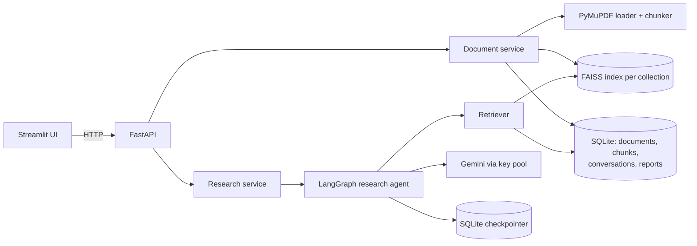
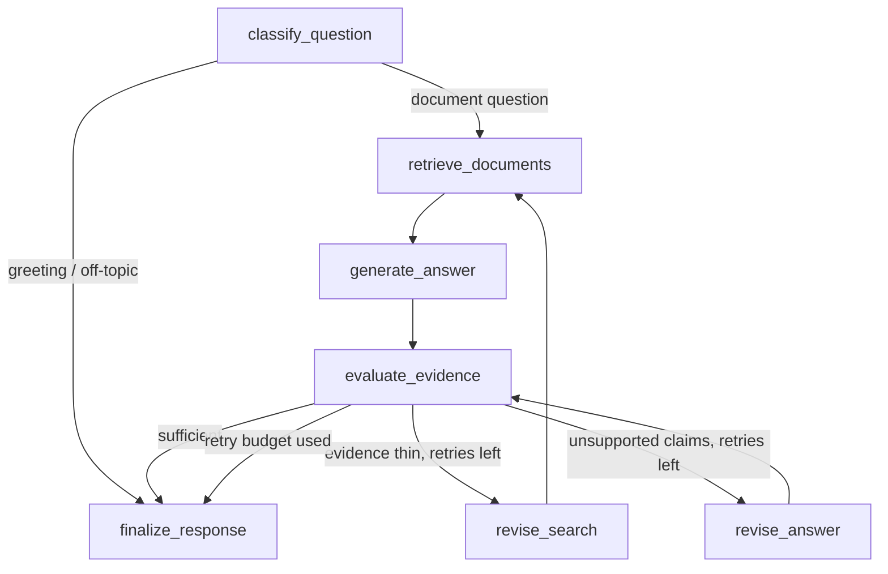

# ResearchFlow AI

**An AI research assistant that answers questions from your own documents — with a citation
for every claim, an agent that fact-checks its own draft, and the honesty to say "the
documents don't say".**

Upload PDFs or text files, ask a question in plain language, and get an answer where each
statement links to the exact document, page and quote it came from. If the evidence is weak
the agent searches again (up to a fixed retry budget); if the documents don't contain the
answer, it says so instead of guessing.

Built with **Python · LangChain · LangGraph · Gemini · FAISS · sentence-transformers ·
FastAPI · Streamlit · SQLite**.

> **Example.** With three short reports about a fictional town loaded, ask *"Why do the pilot
> report and the council memo give different savings figures?"* — the answer explains that
> the pilot report claims an **18%** reduction while the council memo finds **12%** after
> excluding eleven homes that also installed heat pumps, citing both documents. Ask *"What
> was the hourly wage of the solar installers?"* and it searches three times, then answers
> **"Not found in your documents"**.

---

## Features

- **Grounded answers with citations** — every claim carries source labels (`S1`, `S2`…) that
  map to real retrieved passages; citations are validated in code, never invented.
- **Self-checking LangGraph agent** — classify → retrieve → draft → evaluate → (re-search or
  revise) → finalize. Deterministic checks run first, then an LLM judge.
- **Bounded retries** — the retry limit (default 2) lives in graph state and routing, so the
  agent can't loop forever; the best supported attempt is returned as a *partial* answer.
- **Honest failure modes** — `answered`, `partial`, `insufficient_evidence`,
  `not_applicable`, `error`; nothing is shown as an answer when the model fails.
- **Document library** — PDF (PyMuPDF) and TXT ingestion with magic-byte validation, size
  limits, duplicate detection (SHA-256), collections, delete and index rebuild.
- **Semantic search** — sentence-transformers `all-MiniLM-L6-v2` embeddings in a per-collection
  FAISS index; chunk text and metadata live in SQLite.
- **Conversations & reports** — follow-up questions use earlier answers (LangGraph SQLite
  checkpointer); any answer can become a structured Markdown research report.
- **Gemini key pool** — several API keys and fallback models with sticky rotation: when a key
  or model hits its quota, the next one takes over from where it left off.
- **Polished UI** — answer cards with clickable citations, source cards, an "agent path"
  trace, document library and searchable history.
- **Evaluation** — a labelled dataset (including unanswerable questions) with retrieval
  hit@k / MRR and optional LLM-judged answer metrics.

## Architecture



### The research agent (LangGraph)



- **LangChain** provides the prompts, structured outputs (Pydantic schemas), the retriever
  interface and the Gemini chat model.
- **LangGraph** owns the control flow: typed state, pure routing functions, the retry
  counter, and per-conversation memory via the SQLite checkpointer.
- Every node is wrapped so domain errors become an `error` state rather than a crash.

## Project structure

```
app/
  api/routes/        FastAPI endpoints (documents, collections, research, conversations, reports)
  graph/             LangGraph state, nodes, routing, workflow
  ingestion/         loaders (PDF/TXT), chunking, FAISS index manager
  llm/               Gemini gateway, key pool, prompts, structured outputs, embeddings
  persistence/       SQLAlchemy models, repositories, checkpointer
  services/          document, retrieval, research and report services
  evaluation/        evaluation runner
  scripts/           rebuild_index, seed_demo
frontend/            Streamlit app (pages, design system, embedded-API mode)
evaluation/          sample documents and labelled questions
tests/               unit, graph, API and (opt-in) live tests
deploy/huggingface/  single-container image for Hugging Face Spaces
```

## Quick start (Docker — recommended)

```bash
cp .env.example .env            # shared defaults
# put your keys in .env.local (git-ignored):  GOOGLE_API_KEY_1=...  GOOGLE_API_KEY_2=...
docker compose up -d --build
```

- UI: http://localhost:8501 · API docs: http://localhost:8000/docs
- In the UI, open **Document library → Load sample documents** and try the example questions.

## Local development

```bash
python -m venv .venv && source .venv/bin/activate
pip install -e ".[dev]"
uvicorn app.main:create_app --factory --reload          # API on :8000
streamlit run frontend/streamlit_app.py                  # UI on :8501
```

**Intel macOS:** PyTorch has no wheels for this platform, so sentence-transformers can't run
natively. Use Docker, or set `EMBEDDING_PROVIDER=hashing` for development (lexical only —
not for real use).

## Configuration

All settings are environment variables (or `.env` / `.env.local`); see `.env.example`.

| Variable | Purpose | Default |
|---|---|---|
| `GOOGLE_API_KEY_1` … `_10` | Gemini keys, tried in order with sticky rotation | — |
| `CHAT_MODEL` | Primary Gemini model | `gemini-3.5-flash` |
| `CHAT_FALLBACK_MODELS` | Comma-separated models used when the primary's quota is gone | — |
| `EMBEDDING_PROVIDER` | `huggingface`, `fastembed` (no PyTorch) or `hashing` (tests) | `huggingface` |
| `MAX_RETRIES` | Agent retry budget per question | `2` |
| `RETRIEVAL_TOP_K` / `CHUNK_SIZE` | Retrieval and chunking | `5` / `1000` |
| `DATA_DIR` | SQLite databases, uploads, FAISS indexes | `./data` |
| `APP_ACCESS_CODE` | Optional code required to open the UI (public deployments) | — |
| `LANGSMITH_TRACING` | Optional LangSmith tracing | `false` |

**About free-tier quotas:** Gemini free-tier limits apply per Google Cloud *project* and per
model, so extra keys only add capacity when they come from different projects. Fallback
models add capacity too, because each model has its own quota.

## Testing & evaluation

```bash
pytest                         # 111 offline tests — no API keys or network needed
pytest -m live                 # real Gemini calls (uses quota)
ruff check . && mypy app
python -m app.evaluation.run               # retrieval hit@k and MRR
python -m app.evaluation.run --with-llm    # plus answer-quality metrics
```

The offline suite uses scripted fake LLMs to test the graph's routing, retry limits,
citation validation, ingestion edge cases, the key pool and the API.

## Deployment

### Streamlit Community Cloud (free)

1. Fork or push this repo to GitHub.
2. At [share.streamlit.io](https://share.streamlit.io) → **Create app** → choose the repo,
   branch `main`, main file `frontend/streamlit_app.py`; under **Advanced settings** pick
   **Python 3.12**.
3. Paste your secrets (TOML):
   ```toml
   GOOGLE_API_KEY_1 = "..."
   GOOGLE_API_KEY_2 = "..."
   APP_ACCESS_CODE = "choose-a-code"
   ```
4. Deploy. The app runs the API inside the Streamlit process, uses `fastembed` (ONNX) for
   embeddings, and loads the demo documents on first start (sample reports and 10 arXiv
   papers on RAG, retrieval and LLMs).

### Hugging Face Spaces / any Docker host

`deploy/huggingface/` contains a single-container image (API private on :8000, UI on :7860)
and `build_space.sh`, which copies the needed files into a cloned Space repo.

## Rebuilding an index

If you change the embedding model, existing indexes are detected as incompatible. Rebuild:

```bash
python -m app.scripts.rebuild_index            # all collections
```

## Limitations

- No authentication or per-user isolation — everyone shares one workspace.
- No OCR: scanned PDFs are rejected with a clear message.
- Ingestion is synchronous (fine for small batches; large uploads block the request).
- On free hosting, data resets on restart (demo documents reload automatically).
- Free-tier Gemini quotas are small; heavy use exhausts them for the day.
- The LLM judge is an estimate, not a guarantee — citations are checked deterministically,
  but whether a quote fully *supports* a claim is judged by a model.

## Future work

- Background ingestion queue with progress, and OCR for scanned PDFs.
- Hybrid retrieval (BM25 + vectors) and a reranker.
- User accounts and per-user collections.
- Streaming answers and live progress for each agent step.

